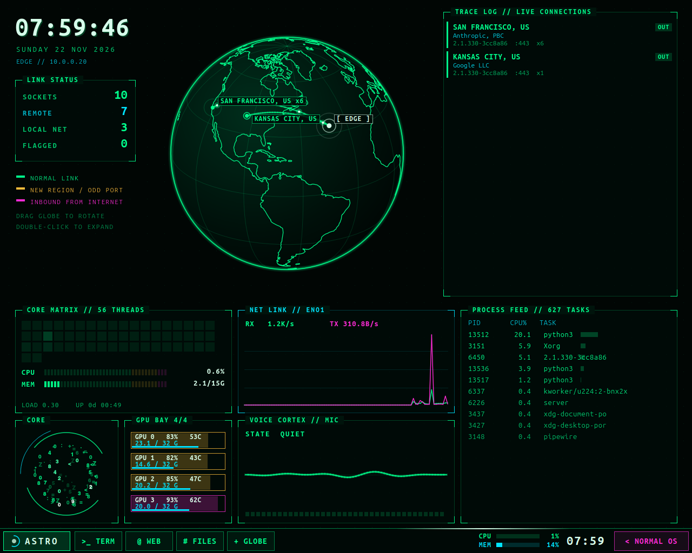
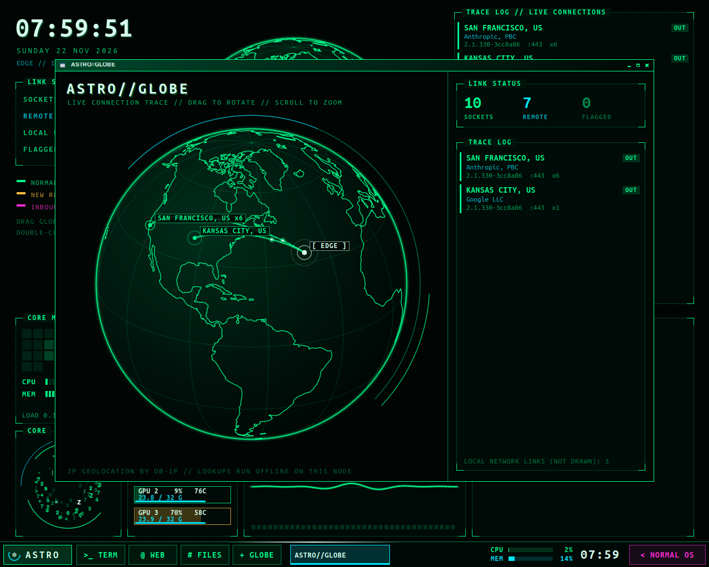
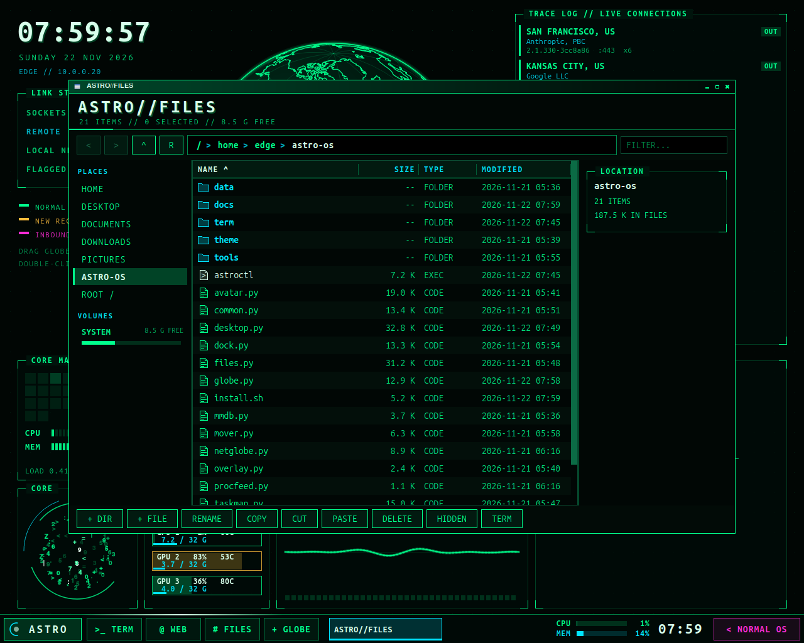
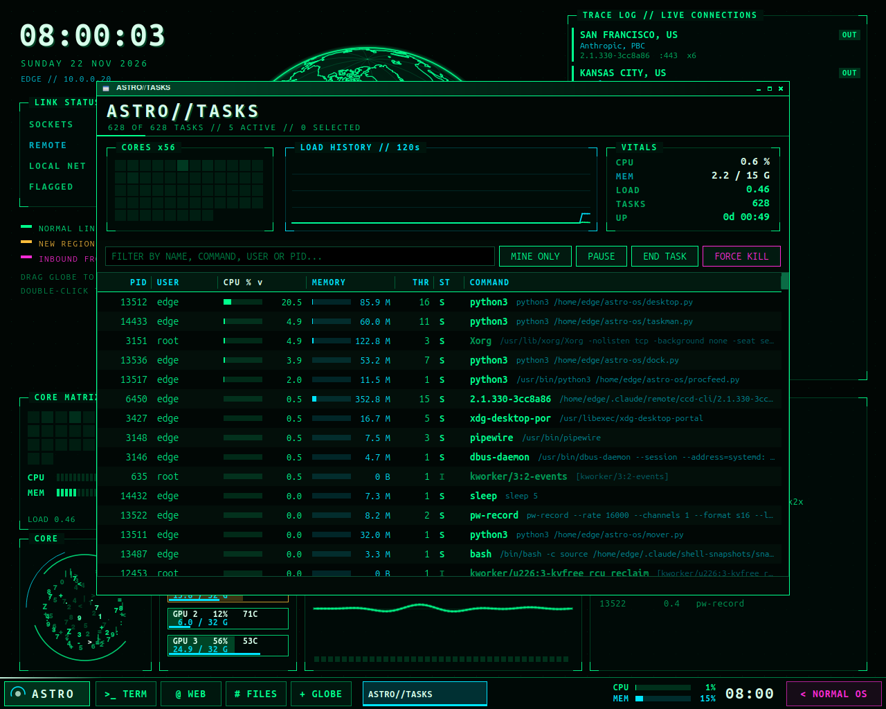
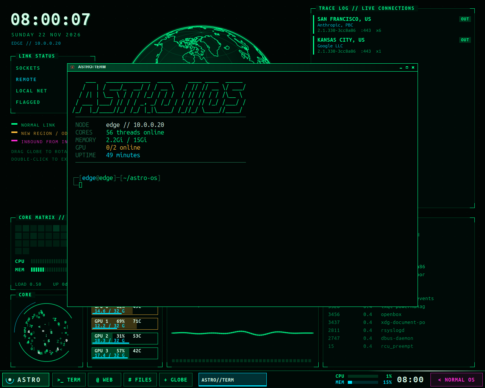
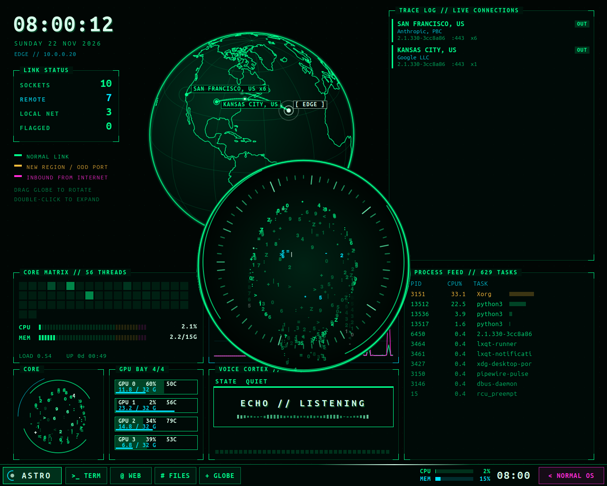

# ASTRO//OS

A live, sci-fi command-deck desktop for Linux servers and workstations. It sits on top of a plain
LXQt session and replaces the panel, wallpaper, window borders, cursor, terminal, file manager and
task manager with one neon-green interface that shows what the machine is doing right now.



*The GPU bay in these screenshots is running on demo data (`ASTRO_FAKE_GPU=1`); everything else is live.*

**[Download ZIP](https://github.com/kingrebelf/Astro-os/archive/refs/heads/main.zip)** ·
[Install](#install) · [Features](#features) · [Using it](#using-it) · [Uninstall](#uninstall)

## Install

On Ubuntu, logged in as the user who will use the desktop:

```bash
curl -fsSL https://raw.githubusercontent.com/kingrebelf/Astro-os/main/install.sh | bash
```

That one command:

1. installs the packages ASTRO//OS needs (asks for your sudo password),
2. on a bare server with no desktop yet, also installs LXQt, Openbox, the SDDM login screen and a browser,
3. downloads ASTRO//OS to `~/astro-os`,
4. fetches the offline IP location databases for the globe (about 70 MB),
5. builds the cursor and window theme, adds a menu entry and a login hook,
6. switches the running desktop over, or tells you to reboot if there was no desktop before.

For a headless box that should boot straight into the desktop, add `--autologin`:

```bash
curl -fsSL https://raw.githubusercontent.com/kingrebelf/Astro-os/main/install.sh | bash -s -- --autologin
```

### From the download instead

Unpack the [ZIP](https://github.com/kingrebelf/Astro-os/archive/refs/heads/main.zip) (or
`git clone https://github.com/kingrebelf/Astro-os ~/astro-os`) wherever you want it to live, then run
the installer from inside it:

```bash
./install.sh
```

### Installer options

| Option | What it does |
|---|---|
| `--autologin` | Log this user straight into the desktop at boot (writes `/etc/sddm.conf.d/10-autologin.conf`). |
| `--no-data` | Skip the location databases. The globe still draws, but shows no cities. |
| `--no-start` | Install only; leave the running desktop alone until the next login. |
| `--dir PATH` | Put ASTRO//OS somewhere other than `~/astro-os`. |

Running the installer again is safe: it updates the checkout and skips whatever is already in place.

### Requirements

- Ubuntu with `apt`. Built and tested on Ubuntu 26.04; other Debian-family systems are untested.
- An X11 session (LXQt + Openbox). The installer sets this up if it is missing. Wayland is not supported.
- Python 3 with PyQt6 (installed for you). No pip packages and no compositor are needed.
- Optional: an NVIDIA driver (`nvidia-smi`) for live GPU readings, and PipeWire for the voice panel.

## Features

### Live desktop

The whole screen is the dashboard: a clock, a globe of where the machine's connections go, per-thread
CPU heat, memory, network throughput, the busiest processes, GPU load and temperature, and a
microphone level meter. Drawing is deliberately light so it stays smooth on a server's onboard video chip.

### Connection globe



Every remote connection is geolocated and drawn as an arc from this machine. Lookups use a local
database, so the list of addresses you talk to never leaves the machine. Connections are flagged
when they come from a region not seen before, use an unusual port, or arrive inbound from the
internet. Drag to rotate, scroll to zoom, double-click the desktop globe to open the full view.

### File manager



Places, breadcrumbs you can type into, a live filter, a preview pane, cut / copy / paste, trash, and
"terminal here".

| Key | Action | Key | Action |
|---|---|---|---|
| `Ctrl+L` | type a path | `Ctrl+F` | filter |
| `Alt+Left` / `Right` / `Up` | back / forward / parent | `F5` | reload |
| `Ctrl+C` / `X` / `V` | copy / cut / paste | `F2` | rename |
| `Ctrl+Shift+N` | new folder | `Delete` | move to trash |
| `Ctrl+H` | show hidden files | | |

### Task manager



Per-core heat grid, load history and a sortable, filterable process table. `Delete` ends the
selected task, `Shift+Delete` force-kills it, `Ctrl+F` filters.

### Terminal



Alacritty with a matching colour scheme, a two-line prompt that shows the last exit code, and a
status banner. Your own `~/.bashrc` is loaded first, so aliases and paths still work.

### ECHO voice avatar



A head made of code glyphs that appears while a dictation app holds the microphone and reacts to
your voice. Only a loudness number is read from the audio; nothing is recorded. It is tuned for
OpenWhispr; set `ASTRO_ECHO_MATCH` to part of another app's name to
follow that one instead. Preview it with `python3 ~/astro-os/avatar.py --demo`.

### Also

- **Dock** with launchers, open windows, a CPU / memory meter and an `ASTRO` menu (settings, tasks, power).
- **Outline window dragging**: a thin frame follows the pointer and the window moves once on release, which keeps slow video chips from smearing.
- **Matching theme** for window borders, the mouse cursor, every Qt app and Firefox.
- **One click back**: `NORMAL OS` in the dock returns to stock LXQt with all of your settings restored.

## Using it

```bash
astroctl on        # enter ASTRO//OS
astroctl off       # back to the normal desktop
astroctl toggle
astroctl restart   # restart the desktop, dock and window mover
astroctl status
astroctl launch term|web|files|tasks|settings|globe
```

`astroctl` works over SSH too: it borrows the display from the running desktop session.

ASTRO//OS remembers whether it was on. If it was, it comes back at the next login; after
`astroctl off` the machine logs in to normal LXQt.

### Settings

`~/.config/astro-os/globe.json` holds the name shown for this machine on the globe and the point the
globe faces when it starts (`[latitude, longitude]`):

```json
{ "home": [34.0, -42.0], "label": "MY-SERVER" }
```

## Updating

```bash
~/astro-os/install.sh
```

## Uninstall

```bash
astroctl off
rm -rf ~/astro-os ~/.config/astro-os ~/.themes/AstroOS ~/.icons/AstroOS
rm -f ~/.local/bin/astroctl ~/.local/share/applications/astro-os.desktop \
      ~/.config/autostart/astro-os.desktop ~/Desktop/astro-os.desktop
```

The packages the installer added are left in place.

## How it is put together

| File | Role |
|---|---|
| `astroctl` | Mode switch: applies and removes the theme, starts and stops the parts. |
| `desktop.py` | The full-screen dashboard. |
| `dock.py` | The bottom dock. |
| `globe.py`, `netglobe.py`, `mmdb.py` | Connection scanner, globe drawing, and a pure-Python reader for the location databases. |
| `files.py`, `taskman.py`, `ui.py` | File manager, task manager, and the widgets they share. |
| `avatar.py`, `voice.py`, `overlay.py` | ECHO avatar, microphone level, dictation-overlay trimming. |
| `mover.py` | Outline window dragging. |
| `theme/` | Generates the cursor and Openbox themes; Qt palette and Firefox styling. |
| `term/` | Alacritty config, prompt and banner. |
| `tools/` | Small helpers for testing: screenshots, simulated clicks and key presses. |

## Credits

- IP geolocation by [DB-IP](https://db-ip.com) (IP to City Lite and IP to ASN Lite, CC BY 4.0). The databases are downloaded by the installer, not stored in this repository.
- Coastlines from [Natural Earth](https://www.naturalearthdata.com) (public domain).
